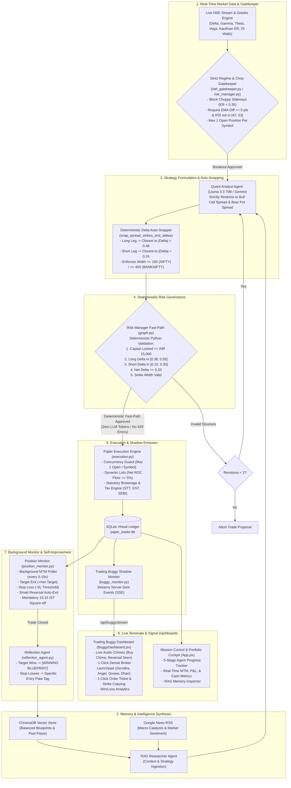

# IronLedger — Autonomous Equity & Options Strategist & Trading Buggy

**IronLedger** is an institutional-grade, hands-free autonomous derivatives trading, risk management, and real-money trade signal platform for Indian index options (**NIFTY**, **BANKNIFTY**, **FINNIFTY**) and high-liquidity F&O equities.

Built on **LangGraph**, **FastAPI**, **ChatGroq (LPU Rotator)**, **Google Gemini 2.5 Flash**, **ChromaDB**, **SQLModel**, and **React (Vite + Tailwind CSS v4)**, the platform continuously scans live market feeds, computes exact Black-Scholes Greeks, applies quantitative regime and momentum gating, enforces strict Chief Risk Officer controls, executes simulated paper orders with statutory tax calculations, and emits real-time actionable signals for manual Demat account execution via **Trading Buggy**.

---

## Complete Multi-Agent & Signal Pipeline Architecture



---

## Key System Highlights & Current Flow (Upgrades 1 to 32)

### 1. All-Day Paper Training Mode (Upgrade 32)
- **Continuous All-Day Session**: Operates without afternoon interruption from **09:15 AM to 15:15 PM IST** (the 13:30 cutoff is removed for comprehensive training).
- **Expanded Daily Trade Caps**: Default session caps elevated to **50 trades/day** (`MAX_DAILY_TOTAL_TRADES=50`, `MAX_DAILY_SYMBOL_TRADES=50`), supporting high-frequency intraday market training.
- **Symbol Concurrency Protection**: Strict database-level concurrency breaker enforces a **maximum of 1 concurrently OPEN position per symbol** (`NIFTY` / `BANKNIFTY`), preventing duplicate orders from stacking on the same candle.
- **Unblocked Afternoon Trends**: `NEUTRAL_FLOW` is unblocked in the pre-trade gatekeeper; whenever trend state indicates `STRONG_UPTREND` or `STRONG_DOWNTREND`, breakout entries are permitted.
- **Calibrated Chop Gatekeeper**: Only blocks scanning when `Trend == "CHOPPY_SIDEWAYS"` (or `FLAT`) **AND** Kaufman Efficiency Ratio `ER < 0.35`.

### 2. Deterministic Delta Auto-Snapping (Upgrade 32)
- **Strategy Normalization**: Restricts all proposed strategies strictly to directional debit spreads: **Bull Call Spread** (Bullish) and **Bear Put Spread** (Bearish), immediately blocking and converting credit spread hallucinations (e.g., Bull Put Spreads or Iron Condors).
- **Auto-Snapping Algorithm**: If LLM-selected strikes violate delta bounds (Long Delta $[0.38, 0.55]$, Short Delta $[0.15, 0.30]$, Net Delta $[0.20, 0.35]$) or minimum strike width:
  - **Does NOT reject or retry**, eliminating repetitive LLM retry loops and API `429 Too Many Requests` rate limits.
  - Automatically snaps the **Long Leg** to the strike in the live option chain closest to $|Delta| = 0.48$.
  - Automatically snaps the **Short Leg** to the strike closest to $|Delta| = 0.24$, guaranteeing spread width $\ge 150$ pts for NIFTY and $\ge 400$ pts for BANKNIFTY.

### 3. Deterministic Risk Manager Fast-Path (Upgrade 32)
- If deterministic Python risk checks pass:
  1. Capital Locked $\le$ ₹15,000 desk cap
  2. Long Leg Delta in $[0.38, 0.55]$
  3. Short Leg Delta in $[0.15, 0.30]$
  4. Net Spread Delta $\ge 0.20$
  5. Strike Width verified ($\ge 150$ NIFTY, $\ge 400$ BANKNIFTY)
  6. Regime & EMA momentum filters satisfied
- **The system auto-approves the trade immediately without calling the Groq LLM**.
- Bypassing the second LLM evaluation cuts Groq token usage by 50% and eliminates hallucinated profit caps or cross-symbol width misunderstandings.

### 4. Balanced ChromaDB Reinforcement Learning (Upgrade 32)
- **`[WINNING BLUEPRINT]` Memory**: For winning trades (`CLOSED_TARGET`), persists a structured blueprint into ChromaDB capturing the exact Regime, Kaufman Efficiency Ratio (`ER`), Put-Call Ratio (`PCR`), and Strike Delta structure (e.g. `Long Delta 0.48, Short Delta 0.24, Width 150 pts`) that succeeded.
- **Specific Entry Flaw Lessons**: For losing trades (`CLOSED_SL`, `CLOSED_TREND_REVERSAL`), tags the exact structural flaw (e.g. low ER $< 0.40$, entering directly into an Open Interest resistance wall) **without blanket-banning the entire regime**.
- **Balanced Context Ingestion**: Quant Analyst prompt retrieves both proven winning blueprints to emulate and specific entry traps to avoid.

### 5. Trading Buggy — Real-Money Trade Signal Provider
- **Parallel Read-Only Shadow Monitor** ([`backend/buggy_monitor.py`](file:///C:/D_Drive/Projects%202.0/Trading_agent/autonomous-strategist/backend/buggy_monitor.py)): Watches the paper trading database and streams actionable trade signals over Server-Sent Events (`GET /api/buggy/stream`).
- **Signal Event Stream**:
  - `BUY_SIGNAL`: New actionable trade setup with exact option strikes, entry premium, target, and stop-loss.
  - `ACTIVE_POSITION_SYNC`: Syncs active open trades smoothly on client connect without redundant chimes.
  - `REVERSAL_ALERT`: High-visibility red flash & warning when spot moves adverse; alerts trader to square off manually before Stop-Loss is hit.
  - `SELL_SIGNAL`: Target or exit reached; automatically shifts trade to completed history with realized P&L.
  - `HEARTBEAT`: 5-second keep-alive pulse tracking connection status.
- **Autoplay-Unlocked Web Audio API Synthesizer**: In-browser audio engine with zero external audio files:
  - **Buy Chime**: Crisp rising two-tone chime (`587Hz -> 880Hz`).
  - **Reversal Siren**: Urgent warble siren (`sawtooth 880Hz -> 440Hz -> 920Hz`).
  - **Sell Chime**: Resolving two-tone chime (`784Hz -> 523Hz`).
  - Global user-gesture listener automatically unlocks audio contexts on first click.
- **Direct Broker Launchpad**: 1-click launch buttons to major Indian trading terminals:
  - **Zerodha Kite** (`https://kite.zerodha.com`)
  - **Groww** (`https://groww.in/stocks/user/explore`)
  - **Angel One** (`https://trade.angelone.in`)
  - **Dhan** (`https://web.dhan.co`)
  - **Upstox** (`https://pro.upstox.com`)
- **Dual-Mode Clipboard Copying**:
  - **"COPY ORDER TO BROKER"**: Copies the complete structured order ticket (Instrument, Strategy, Legs, Entry Net Premium, Target, Stop-Loss, Quantity, Est. Capital).
  - **"COPY STRIKES ONLY"**: Formats clean strike symbols (e.g. `NIFTY 24500 CE, NIFTY 24650 CE`) ready to paste into broker search bars.
  - Resilient copy fallback with hidden textarea + `document.execCommand('copy')` if running in an iframe or non-HTTPS environment.
- **Signal History & Performance Ribbon**: Total completed signals, win rate %, net realized P&L, search by symbol/strategy, and filters for `All`, `Wins`, and `Losses`.

### 6. Realistic Indian F&O Brokerage & Tax Engine (Upgrade 1 & 30)
- Accurately models statutory taxes and transaction costs on Indian exchanges:
  - **STT (Securities Transaction Tax)**: 0.125% on sell-side option turnover.
  - **Exchange Turnover Charges**: NSE options transaction fees.
  - **SEBI Turnover Charges**: Statutory regulatory fees.
  - **Stamp Duty**: State stamp duty on buy turnover.
  - **GST**: 18% applied to brokerage + exchange turnover charges.
  - **Brokerage**: Standard flat ₹20 per executed order.
- Deducts all statutory costs from Gross P&L to reconcile **True Net Realized P&L** on the virtual ledger.

---

## Directory Layout

```
Trading_agent/
├── autonomous-strategist/
│   ├── backend/
│   │   ├── autopilot.py          # Autopilot loop, symbol cycling & telemetry feed
│   │   ├── buggy_monitor.py      # Trading Buggy shadow monitor & SSE signal emitter
│   │   ├── clef_gatekeeper.py    # Cloudflare Clef & intraday momentum gatekeeper
│   │   ├── database.py           # SQLModel virtual ledger (Account, Position, daily caps)
│   │   ├── execution.py          # Paper execution engine, F&O taxes, slippage & concurrency
│   │   ├── graph.py              # LangGraph multi-agent flow with Delta Auto-Snapping & Fast-Path
│   │   ├── groq_pool.py          # Multi-key Groq pool with exponential backoff rotation
│   │   ├── main.py               # FastAPI application with REST & SSE endpoints
│   │   ├── market_data.py        # Live NSE options chain scraper & Black-Scholes Greeks
│   │   ├── position_monitor.py   # Background MTM engine & smart reversal/SL/Target exits
│   │   ├── rag_engine.py         # Google News RSS, ChromaDB vector store & reflections
│   │   ├── reflection_agent.py   # Trade post-mortem learning agent & winning blueprints
│   │   ├── risk_manager.py       # Strict regime, EMA divergence, and momentum gatekeeper
│   │   ├── requirements.txt      # Python dependencies
│   │   ├── paper_trader.db       # SQLite ledger database
│   │   ├── chroma_db/            # Persistent vector embeddings for trade reflections
│   │   ├── test_upgrade_28.py    # Verification suite for F&O taxes & sizing (5/5 tests)
│   │   ├── test_upgrade_31.py    # Verification suite for regime & momentum filters
│   │   └── test_upgrade_32.py    # Verification suite for all-day training & auto-snapping (5/5 tests)
│   └── frontend/
│       ├── src/
│       │   ├── App.jsx           # Main navigation shell & Mission Control cockpit
│       │   ├── BuggyDashboard.jsx# Trading Buggy real-money signal dashboard & broker tools
│       │   ├── main.jsx          # React DOM entrypoint
│       │   └── index.css         # TailwindCSS v4 stylesheet
│       ├── package.json          # Node dependencies
│       └── vite.config.js        # Vite build configuration
├── autonomous_strategist_prompts/ # Autonomous upgrade instruction sequence
├── .env.example                  # Environment configuration template
└── README.md                     # Central platform documentation
```

---

## Getting Started

### Prerequisites
- **Python 3.10+**
- **Node.js 18+**
- **Groq API Key(s)** (supports up to 3 keys in pool: `GROQ_API_KEY1`, `GROQ_API_KEY2`, `GROQ_API_KEY3`) or **Google Gemini API Key**

### 1. Backend Setup

```powershell
cd "autonomous-strategist\backend"

# Activate the virtual environment
..\venv\Scripts\activate

# Install dependencies
pip install -r requirements.txt

# Configure environment variables
# Copy .env.example to .env and insert your API keys
cp .env.example .env

# Run the backend FastAPI server
python main.py
```
- **Backend API**: `http://localhost:8000`
- **Interactive Swagger Docs**: `http://localhost:8000/docs`

### 2. Frontend Setup

```powershell
cd "autonomous-strategist\frontend"

# Install packages
npm install

# Start Vite development server
npm run dev
```
- **Web Dashboard**: `http://localhost:5173`

### 3. Run Automated Verification Tests

```powershell
# Run System Upgrade 32 Verification Suite (All-Day Training, Auto-Snapping, Fast-Path, Memory)
autonomous-strategist\venv\Scripts\python.exe autonomous-strategist/backend/test_upgrade_32.py

# Run System Upgrade 28 Regression Suite (Statutory F&O Charges & Dynamic Lot Sizing)
autonomous-strategist\venv\Scripts\python.exe autonomous-strategist/backend/test_upgrade_28.py

# Run Frontend Production Build Check
npm --prefix "autonomous-strategist/frontend" run build
```

---

## API Reference

### Trading Buggy (Real-Money Signals)
| Method | Endpoint | Description |
|---|---|---|
| `GET` | `/api/buggy/stream` | Server-Sent Events stream emitting `BUY_SIGNAL`, `ACTIVE_POSITION_SYNC`, `REVERSAL_ALERT`, `SELL_SIGNAL`, and `HEARTBEAT` |
| `GET` | `/api/buggy/overview` | Initial state hydration returning active trade ideas and completed trade signals with option legs and P&L |

### Autopilot & LangGraph Pipeline
| Method | Endpoint | Description |
|---|---|---|
| `GET` | `/api/stream/live` | Unified SSE telemetry feed broadcasting all autopilot scans and agent steps |
| `GET` | `/api/stream/{ticker}` | Real-time multi-agent LangGraph SSE stream for a specific ticker |
| `GET` | `/api/autopilot/status` | Current autopilot state, IST session, active scans, and cooldowns |
| `POST` | `/api/autopilot/toggle` | Emergency kill switch to pause or resume autopilot scanning |
| `POST` | `/api/autopilot/scan` | On-demand scan trigger for a specific symbol |

### Virtual Ledger & Portfolio
| Method | Endpoint | Description |
|---|---|---|
| `GET` | `/api/portfolio` | Virtual ledger balance, locked margin, realized P&L, MTM, and active open positions |
| `POST` | `/api/trade/execute` | Fills an approved options proposal on the virtual ledger |
| `GET` | `/api/positions/history` | Audit log of all closed trades with final gross P&L, statutory charges, and net P&L |
| `POST` | `/api/positions/{id}/close` | Manually exits an active position and triggers post-mortem reflection |

### RAG Memory
| Method | Endpoint | Description |
|---|---|---|
| `GET` | `/api/lessons/{ticker}` | Queries ChromaDB for learned post-mortem rules and winning blueprints for an asset |

---

## License

MIT License. Designed for quantitative derivatives trading research, algorithmic simulation, and autonomous agent orchestration.
